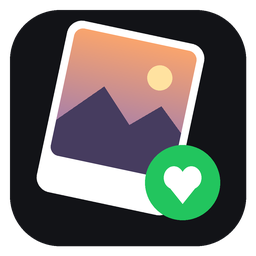
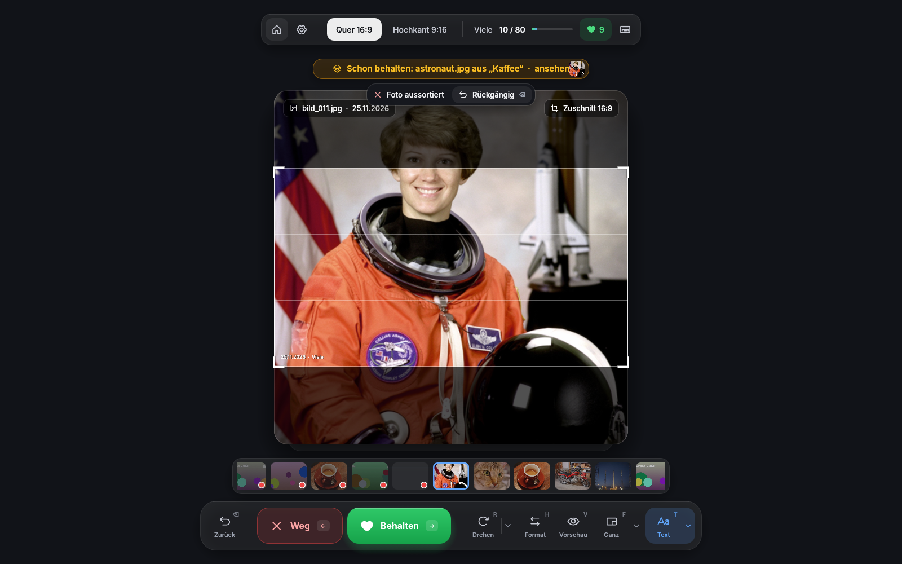

# Bilderrahmen-Swiper

Windows-Programm zum Aussortieren von Fotos für einen digitalen Bilderrahmen. Fotos werden
einzeln angezeigt und per Knopf oder Taste behalten oder übersprungen. Behaltene Fotos
werden passend für den Rahmen zugeschnitten, verkleinert und in einen Zielordner kopiert.
Die Originale werden nicht verändert.



**Download:** [neueste Version](../../releases/latest) → `Bilderrahmen-Swiper.exe` (eine Datei, keine Installation)
**Bedienung:** [ANLEITUNG.md](ANLEITUNG.md) · **Neuerungen:** [CHANGELOG.md](CHANGELOG.md)

**Datenschutz:** Fotos verlassen nie den PC, Originale bleiben unverändert. Netzwerkzugriff gibt es
nur für die Update-Prüfung bei GitHub. Die .exe ist nicht signiert; Windows zeigt beim ersten Start
eine Warnung („Weitere Informationen“ → „Trotzdem ausführen“).

## Wozu

Digitale Bilderrahmen zeigen Fotos mit festem Seitenverhältnis und fester Auflösung.
Handy- und Kamerafotos passen selten direkt: anderes Seitenverhältnis, hochkant, zu groß,
viele ähnliche Aufnahmen. Das Programm verbindet die Auswahl mit der Aufbereitung. Am Ende
steht ein Ordner, der direkt auf Stick oder SD-Karte kopiert werden kann.

## Funktionen

**Auswählen**
- Ordner (auch mehrere, inklusive Unterordner) per Dialog oder Drag-and-drop hinzufügen
- Fotos nach Aufnahmedatum sortiert durchgehen; der Fortschritt pro Ordner bleibt gespeichert (im Zielordner und als Sicherung in AppData)
- Ordner-Menü (⋯ oder kurzer Rechtsklick): aussortierte Fotos nochmal zeigen oder den Ordner ganz von vorn beginnen
- Behalten oder Weg per Knopf oder Taste; Rückgängig auch nach einem Neustart
- Wahlweise zwei Durchgänge: erst schnell sortieren, danach Feinschliff (Zuschnitt, Text) nur für die behaltenen Fotos
- Zeitraum-Filter: nur Fotos aus einem Jahr oder einem frei wählbaren Monatsbereich durchgehen; die Aufnahmedaten werden einmal gelesen und zwischengespeichert
- Verlauf: eine Auswahl von Ordnern lässt sich über das Haus-Symbol unterbrechen und später an derselben Stelle mit denselben Einstellungen fortsetzen; Einträge lassen sich umbenennen und entfernen
- Bilderband mit allen Fotos des Ordners, per Ziehen oder Mausrad scrollbar, Punkte für behalten/weg; ein Klick springt zu einem Bild oder ändert eine Entscheidung
- Serien (Aufnahmen höchstens 2 Sekunden auseinander) und fast gleiche Fotos hintereinander (Bild-Fingerabdruck) werden erkannt und lassen sich nebeneinander vergleichen
- Doppelte Fotos (auch umbenannt oder verkleinert) werden am Bildinhalt und an der Aufnahmezeit erkannt und mit Vorschau angezeigt
- Galerie der behaltenen Bilder mit Filter Quer / Hochkant und „Alle entfernen“ (mit Rückgängig); einzelne Bilder lassen sich wieder entfernen oder nachbearbeiten und neu speichern
- Galerie: Doppelklick zeigt ein Bild groß (Pfeile blättern); Strg-/Shift-Klick markiert mehrere Bilder zum gemeinsamen Entfernen oder Exportieren
- Export der behaltenen Bilder eines Ordners über dessen Drei-Punkte-Menü an einen frei gewählten Ort
- Bei mehreren ausgewählten Ordnern: beim Sortieren über den Ordnernamen zu einem anderen Ordner der Auswahl springen
- Diashow wie auf dem Rahmen: Dauer, Übergang, Reihenfolge, Quer / Hochkant, Aufnahmedatum und Vollbild einstellbar
- Im Zielordner gelöschte Bilder gelten als aussortiert und verschwinden aus Galerie und Zählern
- Große Ansicht per gedrückter rechter Maustaste auf Ordner, Bilderband und Galerie
- Optionales Ziel (z. B. 200 Bilder) mit Zähler

**Aufbereiten**
- Zuschnitt auf das Seitenverhältnis des Rahmens, getrennt für Quer und Hochkant; Rahmen direkt mit der Maus verschieben und an den Ecken skalieren, Startausschnitt automatisch auf Menschen und Details
- Ausschnitt verschieben und zoomen, Drehen in 90°-Schritten
- Hilfslinien wie in Lightroom: Drittel, Goldener Schnitt, Raster, Diagonale, Goldenes Dreieck, Goldene Spirale (Taste O)
- Begradigen um bis zu ±15°: Vorschlag aus erkannten Kanten oder eine selbst gezogene Linie am Horizont
- Licht: automatische Tonwertkorrektur, Helligkeit und Kontrast
- Alternativ das ganze Foto statt Zuschnitt, frei zoom- und verschiebbar; Rand unscharf (Stärke einstellbar), in Fotofarbe, schwarz oder weiß
- Geräte-Vorlagen (z. B. 1280 × 800) setzen Seitenverhältnis und Auflösung automatisch
- Mehrere Profile mit eigenem Format, eigener Größe und eigenem Zielordner; dasselbe Foto kann für jedes Profil behalten werden
- Optionale Begrenzung der Dateigröße (die JPEG-Qualität wird angepasst)
- Optional Text aufs Bild: Datum, Ort (pro Ordner), Notiz (pro Bild)
- Stil-Editor mit Vorschau am echten Foto: vier Schriften, Größe, Farbe, Deckkraft, Hintergrund (Schatten, Band, Glas), neun Positionen und Randabstand; sieben mitgelieferte Stile, eigene Stile speichern, pro Ordner festlegen, als Datei exportieren und importieren
- Wischen: Foto neben dem Zuschnitt-Rahmen nach rechts (behalten) oder links (weg) ziehen
- Ausgabe als JPEG in `Zielordner\Quer` und `Zielordner\Hochkant`, Dateiname mit Aufnahmedatum; Aufnahmedatum (EXIF) und Farbprofil werden mitgeschrieben, übrige EXIF-Daten wie Kamera und GPS nicht

**Abschließen**
- Zusammenfassung mit Anzahl (quer und hochkant) und Gesamtgröße
- Abgleich mit USB-Stick oder SD-Karte: kopiert nur Neues, prüft den nötigen Platz, nimmt auf Wunsch nicht mehr behaltene Bilder vom Stick und wartet, bis alles gespeichert ist
- Rückgängig für alles, was Bilder entfernt (Entscheidungen, Entfernen in der Galerie, Ganz von vorn); entfernte Bilder liegen 14 Tage im Ordner `.papierkorb` im Zielordner
- Reihenfolge auf dem Rahmen: nach Datum, zufällig oder nach Ordner (über eine vierstellige Nummer vor dem Dateinamen; beim erneuten Kopieren werden vorhandene Dateien nur umbenannt)

**Fotowand planen**
- Eigene Ansicht ab der Startseite: Wandmaße in cm, Druckgrößen 9x13 bis 20x30 (auch quadratisch) mit echten, anpassbaren Maßen
- Seitenleiste mit den Reitern Wand, Anordnung und Auswahl; jede Änderung wirkt sofort und die Fotos gleiten an ihre Plätze
- Anordnung als Raster, Reihen oder Collage, fester Rand zur Kante, gleichmäßige Abstände; quer und hochkant gemischt oder alle gleich
- Überlappen als Dachziegel, Mauerwerk oder Schachbrett, verdeckter Anteil pro Foto
- Reihenfolge wie gewählt, nach Datum oder gemischt (Fotos vom selben Tag nicht nebeneinander)
- Hindernisse (Lichtschalter, Möbel) mit eigenem Rand oder „Fotos dürfen dahinter“
- Von Hand gelegte Fotos werden festgepinnt, der Rest ordnet sich drumherum; Zoom mit Strg + Mausrad, zwei Fingern oder Strg + / −
- Rechner unten: Plätze, vorhandene Fotos, was fehlt oder übrig ist, was zu drucken ist
- Für die Wand sortieren: eigenes Profil mit Ordner, Zuschnitt im Format des Abzugs, Ziel = Plätze an der Wand; neue Bilder füllen freie Plätze, Doppelklick öffnet den Zuschnitt
- Fotos aus den behaltenen Bildern oder einem Ordner; verschieben mit Einrasten, tauschen, Größe und Ausrichtung pro Foto, Pfeiltasten, mehrere Wände, Rückgängig

**Bedienung**
- Alle Tasten frei belegbar; die aktuell belegte Taste steht klein auf jedem Knopf, Übersicht der Kürzel mit ? oder F1
- Farbthemen wie Windows, Hell, Dunkel, Sand, Salbei und Nachtblau mit vollflächigem Hintergrund
- Alle Einstellungen in der Leiste unter dem Start-Knopf als kleine Popups: Zeitraum, Ablauf, Text, Profil (Format und Größe) und Zahnrad (Zielordner, Farben, Schrift, Tasten, Hilfe)
- Schriftgröße mit Strg + und Strg −
- Kurze Einführung beim ersten Start
- Hinweis auf neue Versionen; unter Windows Aktualisierung mit einem Klick (Download, Prüfung der SHA-256-Prüfsumme, Austausch der .exe, Neustart)
- „Problem melden“ im Zahnrad: Fehlerbericht (Version, Windows, letzte Protokollzeilen) als Datei und in der Zwischenablage

| Startbildschirm | Serien-Vergleich |
|---|---|
|  |  |


## Einsatzmöglichkeiten

- Urlaubs- oder Familienfotos für einen Bilderrahmen vorbereiten, auch als Geschenk
- Große Fotoordner (etwa 1.000 bis 2.000 Bilder) zügig ausdünnen
- Fotos für Fernseher, Tablets oder Bildschirmschoner auf ein festes Format bringen
- Eine Auswahl aus mehreren Quellen in einem Ordner zusammenführen

## Unterstützte Formate

JPEG, PNG, WebP, BMP, TIFF und GIF direkt. HEIC und HEIF (iPhone) über die
Windows-Bildverarbeitung; dafür müssen die kostenlosen *HEIF-Bilderweiterungen* aus dem
Microsoft Store installiert sein.

## Systemvoraussetzungen und Daten

- Windows 10 oder 11, 64 Bit. Die `.exe` ist eigenständig (rund 19 MB).
- Das Programm arbeitet lokal. Netzwerkverbindungen gibt es nur zu GitHub: die Abfrage der
  neuesten Version und, wenn du es anklickst, deren Download.
- Einstellungen und Vorschaubilder liegen unter `%LOCALAPPDATA%\Bilderrahmen-Swiper`
  (der Vorschau-Speicher wird ab 200 MB automatisch verkleinert), dort steht auch
  `protokoll.txt` mit Fehlermeldungen.
- Welche Fotos behalten oder übersprungen wurden, steht in `.bilderrahmen_status.json`
  im Zielordner, eine Kopie unter `%LOCALAPPDATA%\Bilderrahmen-Swiper\sicherung`.
  Dort liegen auch die zwischengespeicherten Aufnahmedaten und Bild-Fingerabdrücke.
- Die `.exe` ist nicht signiert. Windows SmartScreen fragt deshalb beim ersten Start nach
  („Weitere Informationen“ → „Trotzdem ausführen“).

## Technik

Geschrieben in Rust mit [egui](https://github.com/emilk/egui) für die Oberfläche (Darstellung
über wgpu, OpenGL als Ausweichweg). Laden, Speichern, Vorschaubilder und das Lesen der
Aufnahmedaten laufen in Hintergrund-Threads, damit die Oberfläche flüssig bleibt; das jeweils
nächste Foto wird vorgeladen.

```
src/
  main.rs        Start, Fenster, Grafik-Ausweichweg
  app/           Zustand und Logik, je Thema ein Modul (Ordner, Entscheiden, Bearbeiten,
                 Nachbearbeiten, Serien, Stick, Tasten, Profile, Fotowand)
  history.rs     Rückgängig: Schritte, Papierkorb, Ganz von vorn
  wall/          Fotowand: Druckgrößen, Anordnen (Raster, Reihen, Collage), Reihenfolge,
                 Hindernisse, Pins, Verdeckung, Einrasten
  session.rs     Pausieren und Fortsetzen von Auswahlen (Verlauf)
  daterange.rs   Zeitraum-Filter und Speicher der Aufnahmedaten
  textstyle.rs   Textstile: Voreinstellungen, Export/Import
  update.rs      Ein-Klick-Update unter Windows (mit Prüfsumme)
  report.rs      Fehlerbericht für „Problem melden“
  install.rs     Ablegen im Startmenü/Desktop, Absturz-Hinweis beim nächsten Start
  imaging/       Laden (EXIF-Drehung), Zuschnitt, Ganz-Rand, Begradigen, Licht, Text, JPEG-Export
  dupes.rs       Fingerabdrücke (Differenz-Hash) zum Erkennen doppelter Fotos
  workers.rs     Hintergrund-Threads: Vorladen, Speichern, Vorschaubilder, Aufnahmedaten
  folders.rs     Ordnerbaum, natürliche Sortierung, Fortschrittsdatei
  system.rs      Protokoll, Vorschau-Speicher, Wechseldatenträger, Stick-Abgleich, Update-Abfrage
  wic.rs         Windows Imaging Component als Ausweichweg (HEIC)
  util.rs        kleine Hilfsfunktionen
  ui/
    style.rs     Design-System: Abstände (8er-Raster), Radien, Größen, Farben hell/dunkel, Schriften
    kit/         Bausteine: Glasflächen, Knöpfe, Umschalter, Chips, Meldungen
    icons.rs     Symbole (Phosphor)
    frame.rs     Ablauf eines Frames: Darstellung, Tasten, Hintergrund, Übergänge
    home/, swipe/, wall/, gallery.rs, burst.rs, viewer.rs, textstyles.rs   je eine Ansicht
    popups/, dialogs/   Popups an den Leisten, Einführung und seitliche Felder
assets/fonts/    Inter, Playfair Display, Caveat, Oswald, Phosphor (Lizenzen in LIZENZEN.md)
```

Für KI-Assistenten gibt es eine Landkarte mit Regeln in [`CLAUDE.md`](CLAUDE.md).

### Bauen

```
cargo build --release
```

GitHub Actions (`.github/workflows/windows.yml`) prüft bei jedem Push `cargo fmt --check`,
`cargo clippy --all-targets -- -D warnings` und die Tests, baut die Windows-`.exe` und legt
sie unter *Releases → latest* ab. Die Versionsnummer kommt aus `Cargo.toml`; die
Update-Abfrage in der App vergleicht sie mit dem Titel des Releases. Das funktioniert nur,
wenn das Repository öffentlich ist.

Zum Testen unter Linux: `BRS_RENDERER=glow` erzwingt OpenGL, `BRS_DEBUG=1` gibt Aktionen aus,
`BRS_SIZE=1920x1080` setzt die Fenstergröße.

## Drittanbieter

Schriften [Inter](https://rsms.me/inter/), [Playfair Display](https://github.com/clauseggers/Playfair-Display),
[Caveat](https://github.com/googlefonts/caveat) und [Oswald](https://github.com/googlefonts/OswaldFont)
(alle SIL Open Font License 1.1), Symbole
[Phosphor](https://phosphoricons.com) (MIT). Die Beispielfotos in `docs/` stammen aus den
frei verwendbaren Testdaten von scikit-image.
