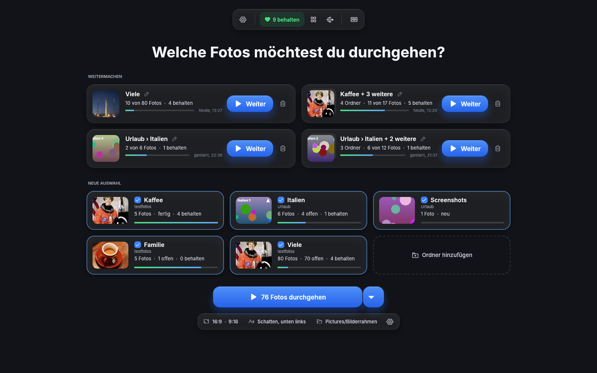
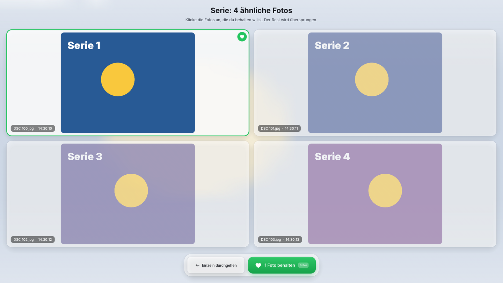
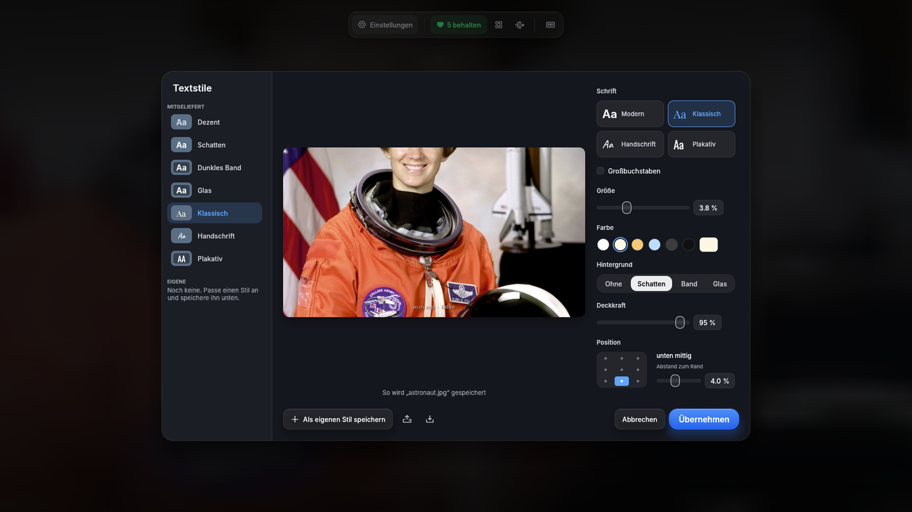

# Bilderrahmen-Swiper

Windows-Programm zum Aussortieren von Fotos für einen digitalen Bilderrahmen. Fotos werden
einzeln angezeigt und per Wischgeste oder Taste behalten oder übersprungen. Behaltene Fotos
werden passend für den Rahmen zugeschnitten, verkleinert und in einen Zielordner kopiert.
Die Originale werden nicht verändert.


**Download:** [neueste Version](../../releases/latest) → `Bilderrahmen-Swiper.exe` (eine Datei, keine Installation)
**Bedienung:** [ANLEITUNG.md](ANLEITUNG.md)

## Wozu

Digitale Bilderrahmen zeigen Fotos mit festem Seitenverhältnis und fester Auflösung.
Handy- und Kamerafotos passen selten direkt: anderes Seitenverhältnis, hochkant, zu groß,
viele ähnliche Aufnahmen. Das Programm verbindet die Auswahl mit der Aufbereitung. Am Ende
steht ein Ordner, der direkt auf Stick oder SD-Karte kopiert werden kann.

## Funktionen

**Auswählen**
- Ordner (auch mehrere, inklusive Unterordner) per Dialog oder Drag-and-drop hinzufügen
- Fotos nach Aufnahmedatum sortiert durchgehen; der Fortschritt pro Ordner bleibt gespeichert
- Behalten oder Weg per Ziehen, Knopf oder Taste; Rückgängig auch nach einem Neustart
- Zeitraum-Filter: nur Fotos aus einem Jahr oder einem frei wählbaren Monatsbereich durchgehen; die Aufnahmedaten werden einmal gelesen und zwischengespeichert
- Verlauf: eine Auswahl von Ordnern lässt sich über das Haus-Symbol unterbrechen und später an derselben Stelle mit denselben Einstellungen fortsetzen; Einträge lassen sich umbenennen und entfernen
- Filmstreifen mit den Nachbarbildern; ein Klick springt zu einem Bild oder ändert eine Entscheidung
- Serien (Aufnahmen höchstens 2 Sekunden auseinander) werden erkannt und lassen sich nebeneinander vergleichen
- Galerie der behaltenen Bilder mit Diashow; einzelne Bilder lassen sich wieder entfernen
- Große Ansicht per gedrückter rechter Maustaste auf Ordner, Filmstreifen und Galerie
- Optionales Ziel (z. B. 200 Bilder) mit Zähler

**Aufbereiten**
- Zuschnitt auf das Seitenverhältnis des Rahmens, getrennt für Quer und Hochkant
- Ausschnitt verschieben und zoomen, Drehen in 90°-Schritten
- Alternativ das ganze Foto statt Zuschnitt, frei zoombar, Rand unscharf, in Fotofarbe, schwarz oder weiß
- Hilfslinien (Drittel, Goldener Schnitt, Spirale …), Begradigen mit Vorschlag, Auto-Verbessern
- Doppelte Fotos werden am Bildinhalt erkannt, behaltene Bilder lassen sich nachbearbeiten
- Mehrere Rahmen mit eigenem Format und Zielordner
- Rahmen-Profile (z. B. 1280 × 800) setzen Seitenverhältnis und Auflösung automatisch
- Optionale Begrenzung von Auflösung und Dateigröße (die JPEG-Qualität wird angepasst)
- Optional Text aufs Bild: Datum, Ort (pro Ordner), Notiz (pro Bild)
- Stil-Editor mit Vorschau am echten Foto: vier Schriften, Größe, Farbe, Deckkraft, Hintergrund (Schatten, Band, Glas), neun Positionen und Randabstand; sieben mitgelieferte Stile, eigene Stile speichern, pro Ordner festlegen, als Datei exportieren und importieren
- Vorschau wie auf dem Rahmen (Taste V) mit Zuschnitt, Auflösung und Text
- Ausgabe als JPEG in `Zielordner\Quer` und `Zielordner\Hochkant`, Dateiname mit Aufnahmedatum; EXIF-Daten und Farbprofil bleiben erhalten

**Abschließen**
- Zusammenfassung mit Anzahl (quer und hochkant) und Gesamtgröße
- Kopieren auf USB-Stick oder SD-Karte mit Platzprüfung; schon vorhandene Dateien werden übersprungen
- Reihenfolge auf dem Rahmen: nach Datum, zufällig oder nach Ordner (über eine vierstellige Nummer vor dem Dateinamen; beim erneuten Kopieren werden vorhandene Dateien nur umbenannt)

**Bedienung**
- Alle Tasten frei belegbar; die aktuell belegte Taste steht klein auf jedem Knopf, Übersicht der Kürzel mit F1
- Einstellungen als Karte mit Seiten für Rahmen und Format, Text, Zielordner, Darstellung und Tasten; die wichtigsten stehen auch auf dem Startbildschirm
- Heller und dunkler Modus (folgt Windows), Schriftgröße mit Strg + und Strg −
- Kurze Einführung beim ersten Start
- Hinweis auf neue Versionen; unter Windows Aktualisierung mit einem Klick (Download, Austausch der .exe, Neustart)

| Startbildschirm | Serien-Vergleich |
|---|---|
|  |  |



## Einsatzmöglichkeiten

- Urlaubs- oder Familienfotos für einen Bilderrahmen vorbereiten, auch als Geschenk
- Große Fotoordner (etwa 1.000 bis 2.000 Bilder) zügig ausdünnen
- Fotos für Fernseher, Tablets oder Bildschirmschoner auf ein festes Format bringen
- Eine Auswahl aus mehreren Quellen in einem Ordner zusammenführen

## Unterstützte Formate

JPEG, PNG, WebP, BMP, TIFF und GIF direkt. HEIC und HEIF (iPhone) über die
Windows-Bildverarbeitung; dafür müssen die kostenlosen *HEIF-Bilderweiterungen* aus dem
Microsoft Store installiert sein.

## Systemvoraussetzungen und Daten

- Windows 10 oder 11, 64 Bit. Die `.exe` ist eigenständig (rund 15 MB).
- Das Programm arbeitet lokal. Netzwerkverbindungen gibt es nur zu GitHub: die Abfrage der
  neuesten Version und, wenn du es anklickst, deren Download.
- Einstellungen und Vorschaubilder liegen unter `%LOCALAPPDATA%\Bilderrahmen-Swiper`
  (der Vorschau-Speicher wird ab 200 MB automatisch verkleinert), dort steht auch
  `protokoll.txt` mit Fehlermeldungen.
- Welche Fotos behalten oder übersprungen wurden, steht in `.bilderrahmen_status.json`
  im Zielordner.
- Die `.exe` ist nicht signiert. Windows SmartScreen fragt deshalb beim ersten Start nach
  („Weitere Informationen“ → „Trotzdem ausführen“).

## Technik

Geschrieben in Rust mit [egui](https://github.com/emilk/egui) für die Oberfläche (Darstellung
über wgpu, OpenGL als Ausweichweg). Laden, Speichern, Vorschaubilder und das Lesen der
Aufnahmedaten laufen in Hintergrund-Threads, damit die Oberfläche flüssig bleibt; das jeweils
nächste Foto wird vorgeladen.

```
src/
  main.rs        Start, Fenster, Grafik-Ausweichweg
  app.rs         Zustand und Logik: Ordner, Entscheidungen, Rückgängig, Serien, Tasten
  session.rs     Pausieren und Fortsetzen von Auswahlen (Verlauf)
  daterange.rs   Zeitraum-Filter und Speicher der Aufnahmedaten
  textstyle.rs   Textstile: Voreinstellungen, Export/Import
  update.rs      Ein-Klick-Update unter Windows
  imaging.rs     Laden (EXIF-Drehung), Zuschnitt, Ganz-Rand, Begradigen, Licht, Text, JPEG-Export
  dupes.rs       Fingerabdrücke (Differenz-Hash) zum Erkennen doppelter Fotos
  workers.rs     Hintergrund-Threads: Vorladen, Speichern, Vorschaubilder, Aufnahmedaten
  folders.rs     Ordnerbaum, natürliche Sortierung, Fortschrittsdatei
  system.rs      Protokoll, Vorschau-Speicher, Wechseldatenträger, Kopieren, Update-Abfrage
  wic.rs         Windows Imaging Component als Ausweichweg (HEIC)
  util.rs        kleine Hilfsfunktionen
  ui/
    style.rs     Design-System: Abstände (8er-Raster), Radien, Größen, Farben hell/dunkel, Schriften
    kit.rs       Bausteine: Glasflächen, Knöpfe, Umschalter, Chips, Meldungen
    icons.rs     Symbole (Phosphor)
    frame.rs     Ablauf eines Frames: Darstellung, Tasten, Hintergrund, Übergänge
    home.rs, swipe.rs, gallery.rs, burst.rs, settings.rs, dialogs.rs,
    textstyles.rs, viewer.rs   je eine Ansicht
assets/fonts/    Inter, Playfair Display, Caveat, Oswald, Phosphor (Lizenzen in LIZENZEN.md)
```

### Bauen

```
cargo build --release
```

GitHub Actions (`.github/workflows/windows.yml`) prüft bei jedem Push `cargo fmt --check`,
`cargo clippy --all-targets -- -D warnings` und die Tests, baut die Windows-`.exe` und legt
sie unter *Releases → latest* ab. Die Versionsnummer kommt aus `Cargo.toml`; die
Update-Abfrage in der App vergleicht sie mit dem Titel des Releases. Das funktioniert nur,
wenn das Repository öffentlich ist.

Zum Testen unter Linux: `BRS_RENDERER=glow` erzwingt OpenGL, `BRS_DEBUG=1` gibt Aktionen aus,
`BRS_SIZE=1920x1080` setzt die Fenstergröße.

## Drittanbieter

Schriften [Inter](https://rsms.me/inter/), [Playfair Display](https://github.com/clauseggers/Playfair-Display),
[Caveat](https://github.com/googlefonts/caveat) und [Oswald](https://github.com/googlefonts/OswaldFont)
(alle SIL Open Font License 1.1), Symbole
[Phosphor](https://phosphoricons.com) (MIT). Die Beispielfotos in `docs/` stammen aus den
frei verwendbaren Testdaten von scikit-image.
